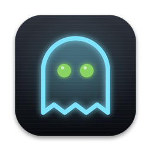
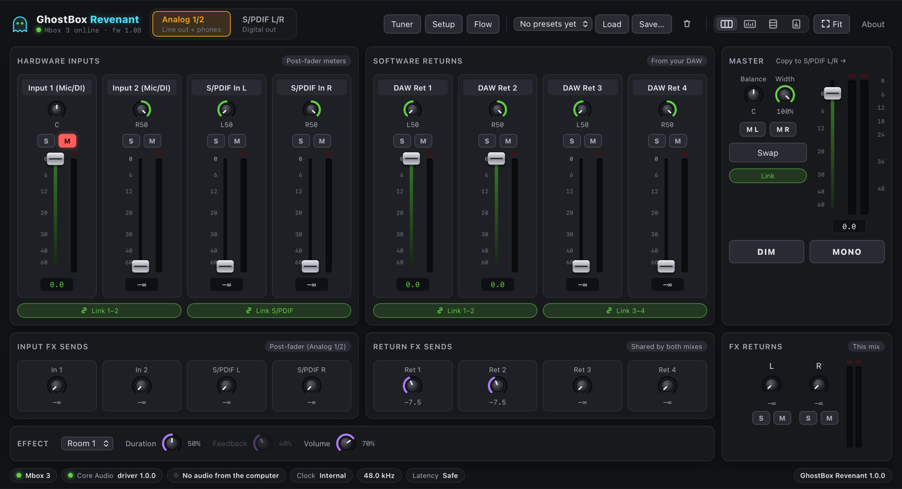
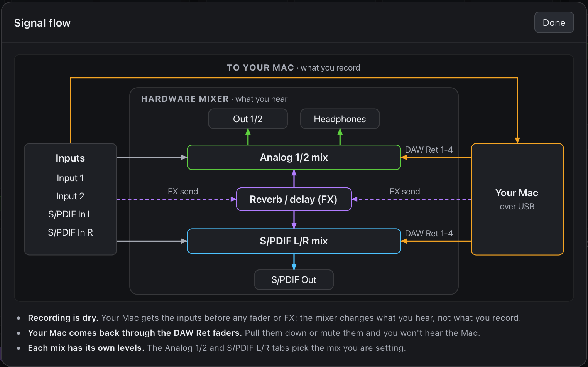

# GhostBox Revenant

<p align="center"></p>

<p align="center"><b>The operations center for the Avid Mbox 3.</b> Abandoned hardware, back from the dead.</p>

<p align="center">
  <a href="https://github.com/isaacmateosv/ghostbox-revenant/actions/workflows/ci.yml"></a>
  <a href="LICENSE"></a>
  
</p>

A modern macOS driver and control panel for the **Avid Mbox (3rd generation, 2010)**, the USB interface Avid
stopped supporting after macOS High Sierra. It turns the Mbox back into a full sound device on current Macs,
Apple Silicon and Intel (hackintoshes included), and gives it a control panel modelled on Avid's original.



> **Status: release candidate.** Built, unit tested and used daily with a real Mbox 3 on one Mac; checks on
> more Macs and macOS versions are under way. See [docs/STATUS.md](docs/STATUS.md).

## What you get

- **Core Audio driver**: 4 inputs (Input 1, Input 2, S/PDIF L/R) and 4 outputs (Software Returns 1-4) at 44.1,
  48, 88.2 and 96 kHz, for Logic, Ableton, any DAW and system audio. Hot plug, S/PDIF rate following, and three
  latency modes. No kernel extension.
- **GhostBox Revenant GUI**: the zero-latency hardware mixer (two stereo mixes), the built-in reverb and delay, the tuner
  (the Mbox's own pitch detection), meters with peak hold and clip indicators, presets, a Hardware Check page and a
  menu bar item. Your mix is saved and restored automatically, even after unplugging.
- **Extras Avid never offered outside Pro Tools**: map the **Multi button** to Play/Pause, Space, Record,
  Dim/Mono or a MIDI message for your DAW; Fit to Window; keyboard control of every fader and knob.
- MIDI In/Out (the 5-pin jacks) works natively.

Universal (Apple Silicon and Intel), macOS 13 Ventura or later. Not affiliated with Avid.

## Install

1. Download `GhostBoxRevenant-<version>.dmg` from [Releases](../../releases), open it and run
   **Install GhostBox Revenant.pkg**.
2. If macOS refuses to open it, go to **System Settings > Privacy & Security** and click **Open Anyway**
   (details per macOS version in [docs/INSTALL.md](docs/INSTALL.md)).
3. Plug in the Mbox and choose **Mbox 3** as input and output in System Settings > Sound or in your DAW.

Updates install the same way, or with **Update Driver…** in the app. Hackintosh notes, uninstalling and
troubleshooting: [docs/INSTALL.md](docs/INSTALL.md).

## Using the panel

- **Two mixes**: *Analog 1/2* feeds Line Out 1/2 and the headphones, *S/PDIF L/R* the digital output (⌘1 / ⌘2).
  Readouts show the exact gain the Mbox applies; click a channel name to rename it.
- **Faders and knobs**: drag (Shift for fine), scroll, or use the arrow keys (1 dB steps, Page Up/Down 6 dB);
  double-click returns to 0 dB. Links pair channels for faders, solo, mute and sends.
- **Fit to Window** (⌘9) scales the whole panel to the window. Layouts: horizontal, vertical, meters only.
- **A solo silences everything else**: a yellow bar warns you, with *Clear solos*.
- **Sample rate**: set it in your DAW or Audio MIDI Setup; Core Audio owns it. **Driver latency** (Setup ⌘, or the
  menu bar): Safe, Balanced or Low.
- **Phantom power, gain, pad and Soft Limit** are analog controls on the Mbox; the Hardware Check page shows live
  levels to set them by. No software can switch them, Avid's included.
- **Tuner** (⌘T, or Dim + Mono on the Mbox) and **Multi button** (Multi Button tab > Learn).
- **Flow** shows how audio moves through the Mbox: the inputs go straight to your Mac (what you record), while the
  hardware mixer builds what you hear.



## How this was built

The Mbox 3 hides its USB Audio Class 2 interface behind vendor class codes, so macOS ignores it, and Avid's last
driver (1.2.13, 2018) needs a kernel extension and 32-bit parts that modern macOS cannot load. Bringing it back
took several stages, each with a different set of helpers:

1. **Listening to the wire** (with Google Gemini): the USB descriptors, and Wireshark with USBPcap capturing the
   traffic of Avid's Windows control panel, showed the device speaking standard USB Audio Class 2 requests to
   numbered units. Gemini also used the [REA](https://github.com/morluto/rea) agent toolkit for binary analysis,
   to put names to the units in the captures; most of those first readings were later disproved on the hardware.
2. **A dead end**: a "codeless kext" telling Apple's audio driver to take the device could not run it, and kernel
   extensions are a poor fit for current macOS. The work moved to user space.
3. **A user-space prototype** (Gemini): `mbox3-ctl`, an IOKit control tool, and a Python web panel
   recreating Avid's control panel. An early driver that fed audio through a separate daemon never produced sound.
4. **The register map, confirmed three ways** (with Anthropic Claude): the Linux kernel's Mbox 3 support, the
   interfaces of Avid's last macOS driver, and experiments on the hardware. Two early conclusions were wrong:
   phantom power is *not* switchable over USB, and the "58-packet handshake" was just a default setup, not an
   unlock. The panel was rebuilt function by function against **DeepSeek**'s condensed version of Avid's user
   guide, which listed every screen and view of the original control panel so nothing would be missed.
5. **A real Core Audio driver** (Claude): a user-space AudioServerPlugIn streaming over isochronous USB. Getting
   clean audio meant packing USB packets back to back, scheduling 5-10 ms ahead of the bus, keeping Core Audio from
   spinning at 100 % CPU, and replugging the Mbox in software after Core Audio restarts.
6. **A native app and a release pipeline** (Claude): a Swift app with a modern panel, the hardware tuner's MIDI
   protocol, tests that need no hardware, universal builds, and GitHub Actions that install the package on
   macOS 15 and 26, Apple Silicon and Intel.

What helped most in the long run: real captures and hardware experiments over guesses, three independent sources
for every register, and a user-space design that needs no kernel extension. The full story, with the early
hypotheses next to what turned out to be true, is in [docs/LOGBOOK.md](docs/LOGBOOK.md).

## Credits

Built and orchestrated by **[isaacmateosv](https://github.com/isaacmateosv)**, with AI assistance from **Google Gemini**, **DeepSeek** and
**Anthropic Claude**. It stands on the Linux kernel's Mbox 3 support by **Conner Knox** and **Manuel Barrio
Linares**. Full credits, including the resources studied and what each contributed: [AUTHORS.md](AUTHORS.md).

## License and legal

Free software under the **GNU General Public License v3.0 or later** ([LICENSE](LICENSE)): use it, study it,
share it, improve it; modified versions must stay free. Provided without warranty.

This is an independent interoperability project. It contains no Avid code, firmware or documentation, and is not
affiliated with or endorsed by Avid Technology, Inc. Avid, Mbox and Pro Tools are Avid's trademarks, used only to
name the hardware. See [NOTICE.md](NOTICE.md).

## For developers

```bash
./build.sh test       # unit tests: driver, MboxKit, app model, engine, panel (no hardware needed)
./build.sh dist       # universal app, driver, installer and disk image, checked, with checksums
```

| Folder | Contents |
|---|---|
| `Sources/Shared` | The Mbox's USB protocol (`MboxProtocol.h`), shared by everything below |
| `Sources/MboxKit` | C API for the control path: device, registers, mixer, clock, Core Audio client |
| `Sources/MboxCtl` | `mbox3-ctl` command-line tool (JSON output) |
| `Sources/Driver` | Core Audio HAL plug-in: object model, USB host, isochronous stream, clock model |
| `Sources/App` | GhostBox Revenant GUI (Swift): Model, Hardware, Core (engine), Services, Server (local API), Shell |
| `Sources/UI` | The control panel: HTML, CSS and ES modules |
| `Tests` | Unit tests (C++, Swift, JavaScript) |
| `Tools` | Artifact checks, CI install test, signing and notarization helpers, hardware test tools |
| `Installer` | Package scripts, the driver install script, read-me, license page, uninstaller |
| `.github` | CI and release workflows, issue form |
| `legacy` | The earlier Python prototype and the previous panel (reference only) |

Documentation: [Architecture](docs/ARCHITECTURE.md) · [USB protocol](docs/PROTOCOL.md) ·
[Logbook](docs/LOGBOOK.md) · [Status](docs/STATUS.md) · [Installing](docs/INSTALL.md) ·
[Releasing](docs/RELEASING.md) · [Contributing](CONTRIBUTING.md) · [Security](SECURITY.md) ·
[Changelog](CHANGELOG.md)
